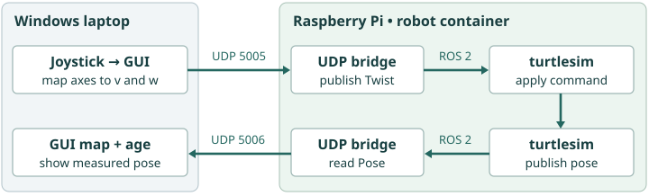
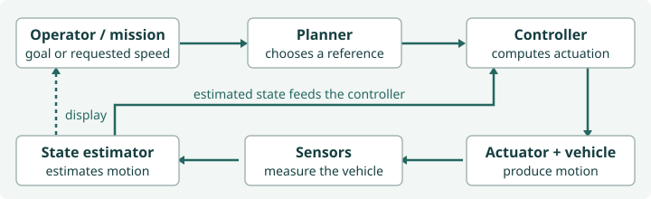
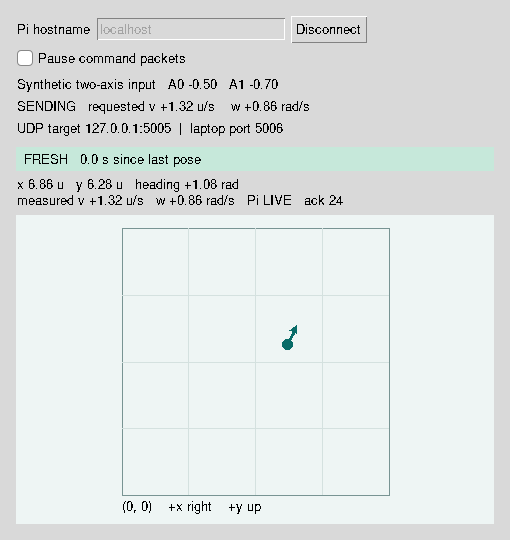

# Student Workshop Guide

<!-- section: Session map -->
## From joystick to motion

**How does an operator command become robot motion, and how can we verify what happened?** In this lab your partner will move a joystick, and you will decide which observation proves that the command reached each part of the system. Switch roles after the first break.

| Elapsed time | Activity | Evidence to collect |
|---|---|---|
| 0:00–0:35 | Compare four robots | A labeled feedback loop |
| 0:35–1:10 | Reach the headless Pi | Hostname, SSH and Git revision |
| 1:10–1:50 | Start Compose and ROS 2 | One command and one pose sample |
| 1:50–2:00 | Break | |
| 2:00–2:35 | Read the joystick | Axis indices, signs and center drift |
| 2:35–3:20 | Drive and interrupt both paths | Two different fault signatures |
| 3:20–3:30 | Break | |
| 3:30–4:05 | Record and replay | Bag, timestamps and run settings |
| 4:05–4:40 | Change and redeploy | A commit and a repeat run |

**Start with a prepared station.** You need the assigned Pi hostname, the Pi login, a wired Logitech controller and local and remote copies of the starter repository. The Installation and Setup Guide prepares all four. Use pages 4–5 to open two VS Code windows. The local Windows window runs the joystick GUI. The SSH window runs commands on the Pi.

<!-- page -->
<!-- section: Block 1  /  35 minutes -->
## Draw the feedback loop

Imagine a USV turning toward a survey line. Its planner selects a desired heading. A heading controller compares that reference with an estimate from the sensors and adjusts differential thrust. Wind and current affect the hull. The next heading measurement lets the controller correct its error.

| Function | Engineering question | One concrete quantity |
|---|---|---|
| Sensing | What can the hardware directly detect? | A gyro measures yaw rate in rad/s. |
| State estimation | What is the vehicle doing now? | An estimator combines gyro and heading observations to estimate yaw. |
| Planning | What reference should we follow next? | A segment of the survey line yields a desired heading. |
| Control | How much actuation will reduce error? | Left and right thrust differ to create a yaw moment. |

**Pair exercise • 10 minutes.** Draw the loop for one platform on the next page. Circle the physical plant. Mark one signal with its units and draw two return paths, one to the controller and one to the operator.

**Expected result.** Your diagram explains how a disturbance can change actual motion while the requested motion stays constant. If the diagram ends at the motor, add the sensor that would let you detect the error.

**Connect it to the turtle.** Today the human chooses the path and closes the outer loop by watching the map. The simulator integrates the velocity request and publishes its own pose. A physical vehicle would need measurements, an estimator and an actuator controller to perform those jobs.

<!-- page -->
<!-- section: Block 1  /  Platform comparison -->
## Follow the same command on four robots

| Platform and mission | Sensors and estimated state | Actuators and onboard computing | Communications and operator interface |
|---|---|---|---|
| UAV • inspect a structure | IMU, barometer and GNSS estimate attitude, height and position. | Flight controller stabilizes attitude. ESCs vary rotor speeds. A companion computer can plan a route. | Pilot radio carries stick inputs. A telemetry link returns position and health to the ground station. |
| USV • survey a waterway | GNSS, compass and IMU estimate position, heading and turn rate. | An onboard computer follows survey lines. Motor controllers set twin propeller thrusts. | Wi-Fi or radio links the boat to a shoreside map and manual controls. |
| AGV • deliver a cart | Wheel encoders, IMU and lidar estimate planar pose and reveal obstacles. | An onboard computer plans an aisle route. Wheel drives regulate speed. | Fleet Wi-Fi carries jobs and status. A dispatch console shows progress. |
| Legged robot • cross uneven ground | Joint encoders, IMU and contact sensing estimate body attitude and foot support. | An onboard computer selects footholds. Joint drives produce the torque to track the gait. | A handheld controller sets body speed. A console displays posture, contact and health. |

**Trace a left turn • 12 minutes.** Pick two platforms. For each, name the operator input, the onboard reference, the physical change that turns the vehicle, and a measurement that would confirm the turn. Explain one way the command could arrive while the turn still fails.

**Expected result.** For a USV you might describe unequal thrust, a yaw moment, then a changing compass heading. For an AGV, unequal wheel speeds can produce a turn. Wheel slip can make encoder estimates disagree with lidar motion.

**Write your own trace.** Use this space to sketch a second platform. Label the commanded quantity and the measurement, with units.

| Selected platform | Your notes |
|---|---|
| Physical cause of the turn | ______________________________ |
| Independent evidence of motion | ______________________________ |

**If the team gets stuck.** Start with the yaw moment on the free-body diagram. Work backward to an actuator that can produce it, then forward to an independent measurement.

<!-- page -->
<!-- section: Block 2  /  First 10 of 35 minutes -->
## Open the Windows workshop folder in VS Code

The Windows laptop reads the USB controller. Open its copy of the project first, then use a second VS Code window for the Pi. On the example laptop, the cloned project is `C:\Users\student\robotics-workshop`. Use your own Windows account name. If you already have PowerShell open at the cloned root, `code -n .` opens it directly in a new VS Code window.

### 1. Open the project folder

From Windows **Start**, open **Visual Studio Code**. If your current window shows **SSH: labpi** or **WSL** in the lower-left corner, keep it open and choose **File > New Window**. Work in the local window for the steps below.

Choose **File > Open Folder...**. Click the folder chooser's address bar, paste the full path to your cloned `robotics-workshop` folder, and press Enter. Click **Select Folder**. You can also browse through **This PC > C: > Users > your account > robotics-workshop**. If Workspace Trust appears, confirm that you trust the course folder you just selected.

### 2. Check the Explorer sidebar

Click the **Explorer** icon on the left, or press **Ctrl+Shift+E**. The top folder should be **robotics-workshop**. Directly beneath it, find `operator_app`, `settings`, `README.md`, and `requirements-windows.txt`. If the top folder is `workshop-kit`, `source` or `operator_app`, use **File > Open Folder...** again and choose the cloned project root.

### 3. Open the integrated terminal

From the top menu choose **Terminal > New Terminal**. Click in the **TERMINAL** panel at the bottom. If its tab shows Bash or Command Prompt, use the arrow beside **+** and choose **PowerShell** or **Windows PowerShell**. Enter these lines one at a time.

**Local VS Code terminal • Windows PowerShell**

~~~powershell
Get-Location
Test-Path .\requirements-windows.txt
Test-Path .\operator_app\__main__.py
~~~

**Checkpoint.** The path ends in `\robotics-workshop` and both checks print `True`. A typical prompt is `PS C:\Users\student\robotics-workshop>`. Type commands after the `>` sign. If only the working directory is wrong, run `Set-Location "$HOME\robotics-workshop"` in this PowerShell terminal and repeat the checks.

<!-- page -->
<!-- section: Block 2  /  Remaining 25 of 35 minutes -->
## Open the Pi in a second VS Code window

A hostname names a machine. DHCP assigns its current IP address. A port selects a service at that address. SSH uses TCP port 22 to open a shell on the Pi. Use the station's verified hostname and login below.

**Local VS Code terminal • Windows PowerShell**

~~~powershell
$Pi = "robot-pi-01.local"
[Net.Dns]::GetHostAddresses($Pi) | Where-Object AddressFamily -eq InterNetwork
Test-NetConnection $Pi -Port 22
ssh "robot@$Pi"
~~~

**Pi host • the same terminal after SSH logs in**

~~~bash
pwd
hostname
ls
cd ~/robotics-workshop
git status --short --branch
git log -3 --oneline
git rev-parse --short HEAD
exit
~~~

In Bash, `~` means your home folder. `pwd` prints the current folder, `ls` lists it, and `cd` changes folders. Record the Pi hostname and Git revision. After `exit`, the terminal shows the Windows `PS C:\...>` prompt again.

**Open the remote editor.** Keep the local project open. Choose **File > New Window**. Press **Ctrl+Shift+P**, choose **Remote-SSH: Connect to Host...**, and select `labpi`. In the connected window the lower-left corner shows **SSH: labpi**. Choose **File > Open Folder...**, enter `/home/robot/robotics-workshop` (use the station login in place of `robot` if different), and confirm with **OK**. Choose **Terminal > New Terminal**.

**Pi host • integrated terminal in the SSH: labpi window**

~~~bash
hostname
pwd
~~~

**Checkpoint.** Expect your station hostname and its Linux project path. Use this window for Docker. Switch to the Windows window for the joystick and GUI.

**If the name fails.** At the Pi console run `ip -4 -br addr` and read the connected Wi-Fi interface. Substitute that current address for `$Pi` and repeat the Windows checks. If the IP works, check station spelling and mDNS. If TCP 22 also fails by IP, check the SSH service and wireless client isolation.

<!-- page -->
<!-- section: Block 3  /  40 minutes -->
## Start the container and inspect ROS

A Docker image contains the installed software. Compose starts a running instance called `robot`. The Pi host provides the network and disk. Inside this container, `/udp_bridge` publishes a velocity command and subscribes to simulator pose. A ROS node is a running participant. A topic is a named stream whose publishers and subscribers agree on a message type.

**Pi host over SSH • repository root**

~~~bash
cd ~/robotics-workshop
docker compose up -d
docker compose ps
docker compose logs --tail 15 robot
docker compose exec robot lab-env bash
~~~

**Pi container • shell just opened**

~~~bash
ros2 node list
ros2 topic list -t
ros2 topic info /turtle1/cmd_vel --verbose
ros2 interface show geometry_msgs/msg/Twist
ros2 topic echo /turtle1/cmd_vel --once
ros2 topic echo /turtle1/pose --once
~~~

| Topic | Publisher → subscriber | Fields to inspect |
|---|---|---|
| `/turtle1/cmd_vel` | UDP bridge → turtlesim | `linear.x` in world units/s and `angular.z` in rad/s |
| `/turtle1/pose` | turtlesim → UDP bridge | `x`, `y`, `theta`, `linear_velocity` and `angular_velocity` |

**Expected result.** With the sticks idle or the GUI disconnected, both commanded components are zero. A freshly started turtle is around (5.54, 5.54) with heading 0. A changed pose can be left over from a previous run. Qt draws the simulator offscreen. The Windows map will display its measured position.

**If a topic is missing.** Check the two node names and the container logs. If `ros2` or the package is missing, leave with `exit` and re-enter through `lab-env` so the shell loads ROS and the workshop package. Stop continuous topic output with Ctrl+C. The detached Compose service keeps running.

**Break • 10 minutes.** Leave the Pi stack running and switch to the local Windows window.

<!-- page -->
<!-- section: Block 4  /  First 8 of 35 minutes -->
## Run the joystick GUI from the VS Code terminal

Plug the Logitech controller into the Windows laptop. Switch back to its **local** VS Code window. Select **Terminal > New Terminal** and choose PowerShell if needed. Click beside the `PS` prompt in the **TERMINAL** panel.

### 1. Check the project and its Python environment

**Local VS Code terminal • Windows PowerShell**

~~~powershell
Get-Location
Test-Path .\requirements-windows.txt
Test-Path .\.venv\Scripts\python.exe
~~~

The path should end in `\robotics-workshop`. The first `True` confirms the project folder. The second checks for the workshop's Python interpreter. On a prepared station both are `True` and you can go straight to step 3.

### 2. First use only • install the Windows dependencies

If the project check is `True` and the interpreter check is `False`, run the two commands below. The first creates `.venv` in the project. The second installs pygame for that interpreter. If `py -3.11` cannot find Python, use the 64-bit Python 3.11 installation steps in the setup guide.

**Local VS Code terminal • Windows PowerShell**

~~~powershell
py -3.11 -m venv .venv
.\.venv\Scripts\python.exe -m pip install -r .\requirements-windows.txt
~~~

### 3. Start the operator application

**Local VS Code terminal • Windows PowerShell**

~~~powershell
.\.venv\Scripts\python.exe -m operator_app
~~~

A separate **Robot operator • turtlesim** window opens. Expect **Local preview** and **OFFLINE** before connecting to the Pi. Move one stick and watch the raw axes and requested velocities change. The `-m operator_app` argument starts the application package from the project root.

**While it runs.** This terminal is busy running the GUI. For a second command prompt, switch back to VS Code and choose **Terminal > New Terminal**. To stop the GUI, close its window with **X**. The original terminal returns to its `PS` prompt. Run the same launch command there next time.

**If startup fails.** For `No module named pygame` run the pip command in step 2. For `No module named operator_app` repeat the folder checks on page 4.

<!-- page -->
<!-- section: Block 4  /  Remaining 27 of 35 minutes -->
## Calibrate the joystick in local preview

Leave the GUI running. In the local VS Code window choose **Terminal > New Terminal** to open a second PowerShell prompt. Run the Windows controller panel from it. Select the Logitech, open **Properties**, and move one axis at a time. Close the controller panel and return to the workshop GUI.

**Local VS Code terminal • second Windows PowerShell prompt**

~~~powershell
joy.cpl
~~~

If the controller has an X/D mode switch, keep its position fixed throughout the experiment. In **Local preview**, record which two raw axes move when you push forward and left. Note each sign and the largest value at center. A normalized axis is roughly -1 to +1. The operator-screen reference at the end of this guide labels the display.

| Action | Observe | Desired result after mapping |
|---|---|---|
| Release both axes | Raw center drift | Both requested values read zero. |
| Push forward only | Index and sign of changing axis | Positive `v`, near-zero `w` |
| Push left only | Index and sign of changing axis | Positive `w`, near-zero `v` |
| Push halfway, then fully | Requested speed | Magnitude increases toward the configured maximum. |

**How the map works.** A deadband of 0.12 suppresses center drift. Outside it the code scales the remaining travel back to 0–1. With raw forward input -0.56, sign -1 and maximum 2.0 u/s, the request is (0.56 - 0.12) / (1 - 0.12) × 2.0 = 1.0 u/s. Here `u` means one turtlesim world unit.

**If the wrong quantity moves.** In the local Explorer expand **settings**, then click **operator.json**. Set `forward_axis` and `turn_axis` to your measured indices, then set each sign to `1` or `-1`. Press **Ctrl+S**. Close the operator window with **X**. Select the original GUI terminal, press **Up Arrow**, then **Enter** to repeat its launch command. If there are no raw axes, check `joy.cpl` and reconnect the USB plug. An absent controller produces zero requests.

**Save a calibrated baseline.** If you changed the mapping, use the spare Windows terminal to commit it before recording. Configure your Git author as described in the setup guide.

**Local VS Code terminal • second Windows PowerShell prompt**

~~~powershell
git diff -- settings/operator.json
git add settings/operator.json
git commit -m "Calibrate joystick axes for this station"
~~~

<!-- page -->
<!-- section: Block 5  /  45 minutes -->
## Drive and diagnose both directions

In the local GUI, enter the verified Pi hostname and select **Connect** with the stick centered. The **FRESH** badge and an advancing `ack` show that return packets are arriving. Push forward briefly, release, then turn left in place. Heading 0 points along +x. A positive turn rotates counterclockwise.

**Pi container • open a second shell if needed**

~~~bash
ros2 topic echo /turtle1/cmd_vel
~~~

Watch `linear.x` and `angular.z` respond. Press Ctrl+C and repeat with `ros2 topic echo /turtle1/pose` to see the measured position and heading. On the GUI, the requested values come from the joystick. The map and measured velocities come from the Pi.

| Fault exercise | Pi evidence | Windows evidence |
|---|---|---|
| A. Hold a small forward input and select **Pause command packets**. | The bridge publishes zeros after 0.50 s without an accepted command, at the next 20 Hz tick. Measured pose settles. | The request remains visible as **PAUSED**. Pose stays **FRESH**, `ack` stops advancing and Pi reports **TIMEOUT**. |
| B. Resume command packets. Interrupt only the return path with the command below. Use a gentle turn. | Command and pose topics continue changing. | After 1.0 s the badge reads **STALE** and the last map marker stays fixed. Actual motion can continue. |

**Pi container • fault B, pause the return path**

~~~bash
ros2 param set /udp_bridge telemetry_enabled false
~~~

Observe the stale display and center the stick.

**Pi container • restore the return path**

~~~bash
ros2 param set /udp_bridge telemetry_enabled true
~~~

**Expected result.** The next accepted pose makes the map fresh again. Write down which signal stopped first for each fault. If the first connection never becomes fresh, compare the Pi command topic while moving the stick. A changing command narrows the investigation to pose publication or the return path. The instructor guide includes the Windows firewall check.

<!-- page -->
<!-- section: Block 5  /  Interface reference -->
## Read a packet like a drawing

UDP sends a datagram to a destination address and port. It does not guarantee delivery or order. Each JSON object fits into one UTF-8 datagram. The Pi accepts a new command only if it passes type, range, session and sequence checks. One active laptop controls each Pi.

| Direction | Socket path | Nominal pace |
|---|---|---|
| Command | Windows IPv4 UDP 5006 → resolved Pi IPv4 UDP 5005 | GUI targets 20 Hz |
| Feedback | Pi UDP 5005 → observed Windows source address and port | Bridge targets 10 Hz when fresh poses are available |

| JSON field | Command packet | Pose packet |
|---|---|---|
| `ver`, `type` | Integer `1`, string `"cmd"` | Integer `1`, string `"pose"` |
| `session` | New 32-character lowercase hex ID on each connection | Echoes the active command session |
| `seq` | Increasing command sequence, starting at zero | Independent increasing telemetry sequence |
| `v`, `w` | Requested forward u/s and yaw rad/s, limited to magnitudes 3 and 4 | Simulator-reported forward u/s and yaw rad/s |
| `ack` | — | Sequence number of the last accepted command |
| `x`, `y`, `theta` | — | World coordinates in u and heading in radians |
| `timed_out` | — | Boolean reporting the Pi command watchdog state |

**Example decoded command • JSON file format**

~~~json
{"ver":1,"type":"cmd","session":"0123456789abcdef0123456789abcdef",
 "seq":24,"v":1.0,"w":0.0}
~~~

**Trace one reply.** The Pi takes the source endpoint from the received datagram. Windows uses that same bound socket to receive the reply. Each machine measures elapsed time with its own monotonic clock. A frozen or invalid pose cannot refresh the GUI. If a second GUI opens on the same laptop, the fixed local port may already be in use.

**Break • 10 minutes.** Center the stick, resume command packets and restore telemetry. Leave the GUI connected for the recording.

<!-- page -->
<!-- section: Block 6  /  35 minutes -->
## Record one repeatable maneuver

Use `arc01` for a fresh run. If it already exists, choose an unused name and change it in every command, including the Windows copy. Center the stick, restore telemetry and keep the GUI connected. The pose and velocity topics both need samples while the turtle is idle.

**Pi host over SSH • repository root**

~~~bash
bash tools/new_run.sh arc01
docker compose exec robot lab-env bash
~~~

**Pi container • reset the starting state and begin recording**

~~~bash
ros2 service call /reset std_srvs/srv/Empty '{}'
ros2 topic echo /turtle1/pose --once
ros2 bag record -s sqlite3 -o /runs/arc01/bag \
  /turtle1/cmd_vel /turtle1/pose
~~~

Wait for both subscription messages. Hold neutral for two seconds, drive forward for one second, add a gentle left turn for one second, then release and wait two seconds. Keep away from the wall. Stop the recorder with Ctrl+C and wait for the shell prompt so SQLite and metadata are finalized.

**Local VS Code terminal • second Windows PowerShell prompt**

~~~powershell
scp .\local\operator-session.json labpi:robotics-workshop/runs/arc01/operator.json
~~~

**Pi host over SSH • remote VS Code window**

Open `runs/arc01/notes.txt` and enter the starting pose, controller mode, maneuver and observation. The GUI writes the effective mapping and Windows Git revision on connection. Copy its sidecar before connecting to another station or run.

**Pi container • inspect the captured evidence**

~~~bash
ros2 bag info /runs/arc01/bag
python3 /opt/lab/tools/inspect_bag.py /runs/arc01/bag \
  /runs/arc01/samples.csv
~~~

**Expected result.** Both topics have nonzero counts. The script prints a motion command, a compatible measured velocity and their recorder-time interval. Open `runs/arc01/samples.csv` in remote VS Code. Find one later pose with changed `x`, `y` or `theta`. If no onset matched, record again with a longer neutral lead-in and a clear forward input.

<!-- page -->
<!-- section: Block 6  /  Replay and interpretation -->
## Compare timestamps, then replay

The CSV preserves the integer recorder timestamp in nanoseconds and elapsed seconds from the first captured sample. `Twist` and `turtlesim/Pose` have no header timestamp. Their recorded interval includes sampling, scheduling and delivery to the recorder. It can differ from physical response time.

| Illustrative row | Time after bag start | What the row means |
|---|---|---|
| Command | 2.000 s | Forward request changes from zero to 1.0 u/s. |
| Pose | 2.018 s | First observed positive measured velocity after the request. |
| Later pose | 2.115 s | Compare position with the idle sample to confirm translation. |

For this illustration the observed interval is 18 ms. Enter your own pair of timestamps and interval in `notes.txt`. A pose may arrive before the recorder writes the associated command, so the automated match is a first compatible observation. Inspect nearby rows if timing looks unusual.

**Prepare for playback.** Center the stick and disconnect the GUI. Leave the live container shell with `exit`. Stop the service so neither the bridge nor turtlesim can publish during observation.

**Pi host over SSH • repository root**

~~~bash
docker compose stop robot
docker compose run --rm --no-deps robot bash
~~~

**Pi container • isolated replay shell**

Start an observer before the player. Its explicit message type lets it subscribe before the topic appears. The file holds one recorded pose. Let playback reach the end.

~~~bash
timeout 45 ros2 topic echo /turtle1/pose turtlesim/msg/Pose \
  --once > /tmp/replayed-pose.txt &
observer=$!
ros2 bag play /runs/arc01/bag --delay 2
wait "$observer"
cat /tmp/replayed-pose.txt
exit
~~~

**Pi host over SSH • return to the live lab**

~~~bash
docker compose up -d
~~~

**Expected result.** The player publishes the two saved streams in recorded order and timing as closely as scheduling permits. The recorded pose stream supplies the observations during playback. To repeat the experiment, restore both source revisions, mapping and image, reset the simulated pose, reconnect and perform the maneuver into a new bag. Timing and human inputs can vary.

<!-- page -->
<!-- section: Block 7  /  35 minutes -->
## Change one value and test the prediction

Predict the full-forward command if you reduce `max_v` from 2.0 to 1.0 u/s and leave the turn scale unchanged. Capture the calibrated revision first. Close the GUI so its next launch will reload the edited settings.

**Local VS Code terminal • Windows PowerShell**

~~~powershell
git status --short --branch
git switch -c lab/lower-speed
~~~

In the local VS Code Explorer expand **settings** and click **operator.json**. Set `max_v` to `1.0` and press **Ctrl+S**. Click back into the PowerShell terminal. Inspect the diff and commit this one change. If your baseline already used 1.0, pick another positive value below 3.0 and record it.

**Local VS Code terminal • Windows PowerShell in the same folder**

~~~powershell
git diff -- settings/operator.json
git add settings/operator.json
git commit -m "Reduce full-forward speed for the comparison run"
git show --stat --oneline HEAD
.\.venv\Scripts\python.exe -m operator_app
~~~

Reconnect by hostname. Repeat the recording exercise as `arc02`, using the same reset, controller and maneuver. Copy the newly written operator sidecar. Compare the two peak commanded velocities and the subsequent changes in position. If only a Windows mapping changed, restarting the GUI deploys it. For a change to the bridge source, rebuild on the Pi.

**Pi host over SSH • only after a Pi source change**

~~~bash
docker compose up -d --build
docker compose exec robot lab-env ros2 topic echo /turtle1/pose --once
~~~

**Recover the earlier behavior.** On your exercise branch, `git revert --no-edit HEAD` creates a new commit that undoes your mapping change. Restart the GUI and check the original maximum. To inspect the distributed baseline separately, use `git show workshop-v1:settings/operator.json`. For publishing your branch to the course GitHub repository, use the setup guide.

**Exit ticket.** Show your partner the two topic samples, both fault signatures, the bag interval and the one-line mapping diff. Point to the Windows and Pi commits in a run folder. Explain what additional evidence you would want before claiming that a physical wheel or propeller followed its command.

<!-- page -->
<!-- section: Field reference  /  Windows operator -->
## Locate each measurement on the GUI

The screenshot shows the workshop GUI during a loopback check with synthetic input and pose. On a classroom laptop, enter your Pi hostname in the first field. The controller name and axis readings come from the attached Logitech.

| Display | How to read it |
|---|---|
| Raw axes and requested velocities | A0 and A1 are dimensionless stick readings. SENDING means the GUI is trying to transmit the mapped values. PAUSED keeps the requested values visible. |
| FRESH / STALE and age | Windows measures time since its last accepted pose. The badge and color describe the return path. |
| Measured v, w, Pi LIVE / TIMEOUT and ack | The simulator reports velocity. The bridge reports its command watchdog and last accepted command number. |
| Map marker and arrow | Position comes from x and y. Heading is the arrow direction. Gray marks the last received pose during a stale interval. |

**Read this frame.** The requested turn is positive and the arrow points up and right. The receipt of command 24 and a recent pose show evidence in both directions. To prove translation, compare the current position with a second sample.
